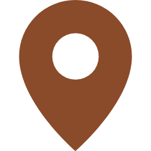

# Carte des artisans pour Home Assistant



Intégration personnalisée de [Home Assistant](https://www.home-assistant.io/)
qui indique les artisans d'un métier autour de votre maison, à partir des
données publiques de la [Carte des artisans](https://cartedesartisans.fr/) :
Sirene (Insee), répertoire des métiers (chambres de métiers et de
l'artisanat), labels RGE (ADEME) et EPV (DGE) ; plus de 3 millions
d'établissements, mis à jour chaque mois.

La Carte des artisans est un site indépendant, non affilié à l'Insee ni aux
chambres de métiers et de l'artisanat.

- **Capteurs** : nombre d'artisans dans le rayon, et premier artisan (le plus
  proche, labellisés d'abord) avec la liste des 10 premiers en attributs (téléphone, adresse, distance, liens
  vers la fiche et l'itinéraire).
- **Action `carte_des_artisans.chercher_artisan`** : renvoie les artisans d'un
  métier autour de la maison ou d'un point donné, pour une automatisation, un
  script ou Assist.
- Métier au choix parmi les rubriques du site (plombier, électricien,
  serrurier, boulanger...), rayon de 5, 10, 25 ou 50 km, entreprises
  labellisées seulement si vous le souhaitez.

[](https://my.home-assistant.io/redirect/marketplace_repository/?owner=tlse-vins&repository=ha-carte-des-artisans&category=integration)

## Sommaire

- [Installation](#installation)
- [Configuration](#configuration)
- [Entités](#entités)
- [Action « Chercher un artisan »](#action--chercher-un-artisan-)
- [Ordre des résultats](#ordre-des-résultats)
- [Vie privée](#vie-privée)
- [Données et licence](#données-et-licence)
- [Limites](#limites)
- [Dépannage](#dépannage)
- [Développement](#développement)
- [English](#english)

## Installation

Home Assistant 2026.3 ou plus récent.

### Par la Marketplace (Home Assistant 2026.11 et plus) ou HACS

En attendant son inscription au catalogue, l'intégration s'ajoute comme dépôt
personnalisé :

1. Cliquez sur le bouton ci-dessus (« Marketplace »). Il ouvre le dépôt dans
   votre Home Assistant et propose de l'ajouter s'il n'est pas encore connu.
   Avant la version 2026.11, avec HACS, utilisez plutôt
   [ce lien](https://my.home-assistant.io/redirect/hacs_repository/?owner=tlse-vins&repository=ha-carte-des-artisans&category=integration),
   qui ouvre HACS (ou la Marketplace sur les versions récentes).
2. Sans les liens « My Home Assistant » : menu ⋮ › **Dépôts personnalisés**,
   adresse `https://github.com/tlse-vins/ha-carte-des-artisans`, type
   **Intégration**.
3. Téléchargez **Carte des artisans**, puis redémarrez Home Assistant.

### Installation manuelle

1. Téléchargez la dernière version depuis la page
   [Releases](https://github.com/tlse-vins/ha-carte-des-artisans/releases).
2. Copiez le dossier `custom_components/carte_des_artisans` dans le dossier
   `custom_components` de votre configuration Home Assistant (créez-le s'il
   n'existe pas).
3. Redémarrez Home Assistant.

Une installation manuelle ne se met pas à jour toute seule : recommencez à
chaque nouvelle version.

## Configuration

**Paramètres › Appareils et services › Ajouter une intégration › Carte des
artisans.**

| Réglage | Description |
| --- | --- |
| Métier | Rubrique du site (ex. « Dépannage maison › Plombier »). |
| Rayon | 5, 10, 25 ou 50 km autour du lieu. |
| Labellisés seulement | Ne garder que les entreprises RGE, EPV ou Maître artisan. |
| Position de la maison | Coché : la position de la maison (Paramètres › Système › Général), suivie si elle change. Décoché : un lieu choisi sur une carte à l'étape suivante. |

Ajoutez une entrée par métier ou par lieu (plombier près de la maison,
électricien près d'une résidence secondaire...). Le rayon, le filtre et le
lieu se modifient ensuite par **Configurer** sur l'entrée.

Les données sont relues toutes les 6 heures ; les fichiers du site ne changent
qu'à la mise à jour mensuelle, ils ne sont donc téléchargés de nouveau qu'à ce
moment.

## Entités

Chaque entrée crée un appareil de service portant le nom de l'entrée et deux
capteurs.

### Artisans dans le rayon

État : nombre d'établissements du métier dans le rayon.

| Attribut | Description |
| --- | --- |
| `rubrique` | Métier recherché. |
| `rayon_km` | Rayon en km. |
| `labellises_seulement` | Filtre « labellisés seulement ». |
| `lien_carte` | Lien vers la carte du site pour ce métier et cette zone. |
| `donnees_du` | Date des données du site. |

### Premier artisan

État : nom du premier artisan de la liste (voir
[Ordre des résultats](#ordre-des-résultats)) ; inconnu s'il n'y en a aucun.

Attributs : les champs du premier artisan (tableau ci-dessous), et
`artisans`, la liste des 10 premiers avec les mêmes champs. Cette liste n'est
pas enregistrée dans l'historique.

| Champ | Description |
| --- | --- |
| `nom` | Dénomination de l'établissement. |
| `enseigne` | Enseigne, si elle diffère du nom. |
| `activite` | Activité de l'établissement. |
| `adresse`, `commune` | Adresse complète, commune. |
| `distance_km`, `distance` | Distance à vol d'oiseau, en km (nombre) et en texte (« 1,2 km »). |
| `labels` | Labels : RGE, EPV, Maître artisan. |
| `telephone`, `site` | Seulement si l'artisan les a ajoutés sur sa fiche du site ; sinon vides. |
| `position_approximative` | Vrai si l'établissement est placé au centre de sa commune. |
| `latitude`, `longitude` | Position de l'établissement. |
| `lien` | Fiche de l'établissement sur le site. |
| `itineraire` | Lien d'itinéraire vers l'établissement. |

Exemple de carte de tableau de bord (Markdown) ; remplacez les identifiants
d'entités par les vôtres (Paramètres › Entités) :

```yaml
type: markdown
title: Plombiers à proximité
content: >
  
  - **[{{ a.nom }}]({{ a.lien }})** · {{ a.distance }} · {{ a.labels | join(', ') }} · {{ a.telephone }}
  
  Aucun artisan dans le rayon.
  
```

## Action « Chercher un artisan »

`carte_des_artisans.chercher_artisan` est disponible dès que l'intégration a été ajoutée une fois (au moins un métier configuré), pour n'importe quel métier.

| Champ | Obligatoire | Description |
| --- | --- | --- |
| `metier` | oui | Titre de la rubrique (« Plombier », « Électricien »...), sans tenir compte des majuscules ni des accents, ou sa clé (`maison-depannage.plombier`). |
| `rayon` | non | 5, 10 (par défaut), 25 ou 50 km. |
| `labellises` | non | Seulement les entreprises labellisées (faux par défaut). |
| `latitude`, `longitude` | non | Centre de la recherche, les deux ensemble ; par défaut la maison. |
| `nombre` | non | Nombre d'artisans renvoyés, de 1 à 50 (5 par défaut). |

Réponse :

| Clé | Description |
| --- | --- |
| `trouve` | Vrai si au moins un artisan a été trouvé. |
| `nombre` | Nombre total d'artisans dans le rayon. |
| `metier` | Titre de la rubrique retenue. |
| `rayon_km` | Rayon utilisé. |
| `artisans` | Liste des premiers artisans, mêmes champs que ci-dessus. |
| `lien_carte` | Lien vers la carte du site pour ce métier et cette zone. |

Essai : **Outils de développement › Actions**, choisir « Carte des artisans :
Chercher un artisan », puis **Effectuer l'action** pour voir la réponse.

### Exemple : notification en cas de fuite d'eau

```yaml
automation:
  - alias: "Fuite d'eau : plombiers à proximité"
    triggers:
      - trigger: state
        entity_id: binary_sensor.detecteur_fuite_cuisine
        to: "on"
    actions:
      - action: carte_des_artisans.chercher_artisan
        data:
          metier: Plombier
          rayon: 10
          nombre: 3
        response_variable: resultat
      - action: notify.mobile_app_mon_telephone
        data:
          title: "Fuite d'eau détectée"
          message: >
            
            
            {{ a.nom }} ({{ a.distance }}) : {{ a.telephone }}
            
            
            Aucun plombier dans un rayon de {{ resultat.rayon_km }} km.
            
          data:
            # Lien ouvert en touchant la notification (iPhone : url, Android : clickAction)
            url: "{{ resultat.artisans[0].lien if resultat.trouve else resultat.lien_carte }}"
            clickAction: "{{ resultat.artisans[0].lien if resultat.trouve else resultat.lien_carte }}"
```

### Exemple : script pour Assist

Un script qui renvoie une réponse peut être exposé à Assist (y compris à un
agent de conversation basé sur un modèle de langage) : **Paramètres › Assist ›
Exposer**, puis cochez le script. Assist remplit les champs à partir de la
question (« Trouve-moi un électricien labellisé près de la maison »).

```yaml
script:
  chercher_artisan:
    alias: Chercher un artisan
    description: >
      Cherche les artisans d'un métier près de la maison (France
      métropolitaine et Corse) et renvoie leur nom, téléphone, distance et
      lien vers leur fiche.
    fields:
      metier:
        description: "Métier recherché, par exemple Plombier, Électricien, Serrurier."
        required: true
        selector:
          text:
      labellises:
        description: "Seulement les entreprises labellisées RGE, EPV ou Maître artisan."
        selector:
          boolean:
    sequence:
      - action: carte_des_artisans.chercher_artisan
        data:
          metier: "{{ metier }}"
          labellises: "{{ labellises | default(false) }}"
          rayon: 25
          nombre: 5
        response_variable: resultat
      - stop: Résultat de la recherche
        response_variable: resultat
```

## Ordre des résultats

Mêmes règles que le site
([faq.html#classement](https://cartedesartisans.fr/faq.html#classement)) :
entreprises labellisées (RGE, EPV, Maître artisan) d'abord, puis les plus
proches. L'intégration n'affiche aucune entrée « Sponsorisé » et aucune
publicité ; l'ordre n'est influencé par aucun paiement.

## Vie privée

- La position de la maison ou du lieu choisi ne sert qu'aux calculs de
  distance, dans Home Assistant : elle n'est jamais envoyée, ni placée dans un
  lien.
- L'intégration ne télécharge que des fichiers publics du site :
  `https://cartedesartisans.fr/donnees/export/` (liste des métiers, communes,
  un fichier par département et activité, seulement pour les départements à
  portée du rayon), ainsi que `maitres-artisans.js` et `enrichies.js`
  (informations ajoutées par les artisans). Aucun compte, aucune clé.
- Les liens vers le site portent `mtm_campaign=homeassistant` : si vous les
  ouvrez, la mesure d'audience du site, sans cookie, compte ces visites comme
  venant de Home Assistant. Détails et refus :
  [confidentialite.html#mesure-audience](https://cartedesartisans.fr/confidentialite.html#mesure-audience).

## Données et licence

- Données : base Sirene de l'Insee, répertoire des métiers (référentiel NAFA
  des chambres de métiers et de l'artisanat), liste des entreprises RGE
  (ADEME), entreprises du patrimoine vivant (DGE) ; licence ouverte
  (Etalab 2.0), contenu non modifié, mis à jour une fois par mois. Voir les
  [mentions légales](https://cartedesartisans.fr/mentions-legales.html) du
  site.
- Une erreur sur un établissement, ou une demande de retrait :
  [signaler.html](https://cartedesartisans.fr/signaler.html).
- Code de l'intégration : licence [Apache-2.0](LICENSE).

## Limites

- France métropolitaine et Corse seulement (pas de DOM).
- Établissements actifs et diffusibles inscrits au répertoire des métiers, ou
  dont l'activité principale est artisanale.
- Distances à vol d'oiseau. Certaines positions sont approximatives (centre de
  la commune) : attribut `position_approximative`.
- Le téléphone et le site ne sont connus que si l'artisan les a ajoutés sur sa
  fiche.

## Dépannage

- **« Position inconnue »** : renseignez la position de la maison
  (Paramètres › Système › Général), ou passez `latitude` et `longitude` à
  l'action.
- **« Métier inconnu »** : utilisez le titre d'une rubrique tel qu'il apparaît
  dans la liste « Métier » de la configuration.
- **Rubrique retirée du site** : une réparation apparaît dans
  Paramètres › Système › Réparations ; supprimez l'entrée et recréez-la avec un
  autre métier.
- **Capteurs indisponibles** : le site n'a pas répondu ; l'intégration réessaie
  à la relecture suivante. Les diagnostics de l'entrée (menu ⋮ › Télécharger
  les diagnostics) aident à signaler un problème, sans la position.
- Journal détaillé :

  ```yaml
  logger:
    logs:
      custom_components.carte_des_artisans: debug
  ```

Problèmes et suggestions :
[tickets](https://github.com/tlse-vins/ha-carte-des-artisans/issues).

## Développement

Les tests utilisent `pytest-homeassistant-custom-component` et un faux site
(`tests/site/`) : aucun accès réseau. Ils demandent Python 3.14 ; le plus
simple est Docker :

```bash
docker run --rm -v "$PWD:/depot" -w /depot python:3.14 \
  sh -c "pip install -q -r requirements_test.txt && pytest"
```

Sous Windows (PowerShell), remplacez `"$PWD:/depot"` par `"${PWD}:/depot"`.
Le script de publication se teste sans dépendance :
`python .github/scripts/test_release.py`.

Les workflows GitHub lancent les contrôles HACS (`validate.yaml`), hassfest
(`hassfest.yaml`) et les tests (`tests.yaml`). Pour publier une version :
décrire les changements sous `## [Unreleased]` dans `CHANGELOG.md`, puis
**Actions › Release › Run workflow** (patch, minor ou major) : version du
manifest, étiquette et GitHub Release.

Une intégration sœur existe pour Gladys Assistant :
[gladys-carte-des-artisans](https://github.com/tlse-vins/gladys-carte-des-artisans).

## English

**Carte des artisans** is a Home Assistant custom integration listing the
craftspeople and trade businesses of a given trade around your home in France
(mainland and Corsica), from the open data published by
[cartedesartisans.fr](https://cartedesartisans.fr/) (Insee Sirene register,
chambers of trade directory, RGE and EPV labels; updated monthly). The website
is independent, not affiliated with Insee nor with the chambers of trade.

- **Install**: add `https://github.com/tlse-vins/ha-carte-des-artisans` as a
  custom repository (type Integration) in the Marketplace (Home Assistant
  2026.11+) or HACS, download it and restart; or copy
  `custom_components/carte_des_artisans` into your configuration folder.
  Requires Home Assistant 2026.3 or later.
- **Configure** from Settings › Devices & services: trade, radius (5, 10, 25
  or 50 km), certified businesses only, home location or a chosen place. One
  entry per trade or place.
- **Entities**: "Craftsmen in the radius" (count) and "First craftsman"
  (certified first, then nearest; the first 10 results in the `artisans`
  attribute).
- **Action** `carte_des_artisans.chercher_artisan` (fields `metier`, `rayon`,
  `labellises`, optional `latitude`/`longitude`, `nombre`) returns `trouve`,
  `nombre`, `metier`, `rayon_km`, `artisans` and `lien_carte`; use it with
  `response_variable` in automations, or expose a script to Assist.
- **Ranking**: certified businesses (RGE, EPV, Maître artisan) first, then the
  nearest. No sponsored entries, no ads.
- **Privacy**: your location never leaves Home Assistant; only public files of
  cartedesartisans.fr are downloaded. Links to the site carry
  `mtm_campaign=homeassistant` (cookieless audience measurement).
- **License**: code Apache-2.0; data under the French Open Licence
  (Etalab 2.0).
